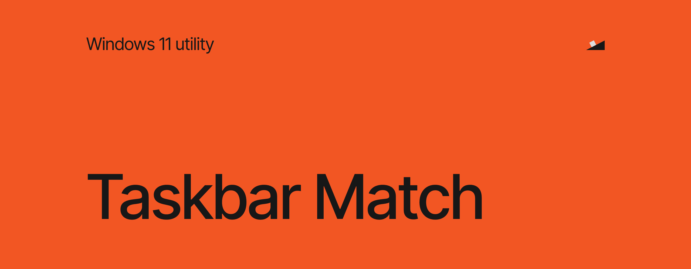
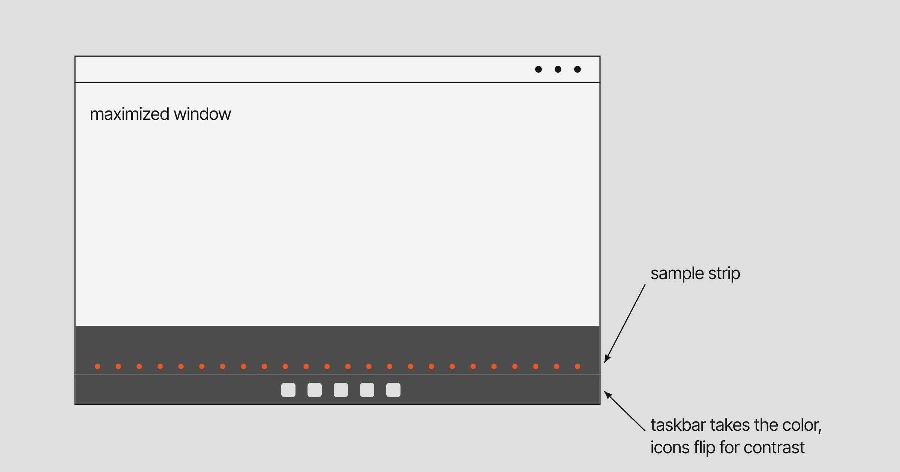

The Windows 11 taskbar has one color, and it doesn't care what is above it. Maximize a dark editor and you get a light bar under it, or the other way round, and the screen ends in a strip that looks like it belongs to another app.

Taskbar Match makes the taskbar continue the window next to it. It reads a thin strip at the edge of the maximized window, gives the taskbar that color and flips the text and icons to dark or light so they stay readable. When no window touches the taskbar, it hands the bar back to Windows. It works on every monitor and needs no administrator rights.



## How it works

Whenever windows change, and every few moments in between, Taskbar Match looks for the maximized window that borders each taskbar and reads a strip a few pixels thick along the edge that touches the taskbar, never a screenshot of the screen. It takes the dominant color of that strip, sets it as the taskbar background through a small native helper and picks dark or light icons by contrast. It keeps the original taskbar values and puts them back when you pause or exit. If it crashes, Explorer restores them on its own.

Full-screen games and videos are left alone, and so is a hidden taskbar. Since 1.2.0 the taskbar can sit on any edge of the screen: bottom, top, left or right.

## Install

1. Download `TaskbarMatch.exe` from the [latest release](../../releases).
2. Double-click it. The tray icon shows that it runs.

The beta is not signed yet, so Windows may warn you about an unfamiliar app the first time.

To start it with Windows, enable **Start with Windows** in the tray menu. This copies the executable to `%LOCALAPPDATA%\TaskbarMatch\TaskbarMatch.exe` and starts it from there at sign-in, so you can delete the download afterwards. The tray menu also has **Pause and restore**, **Refresh now**, **Diagnostics** and **Exit and restore taskbars**.

## Requirements

- Windows 11 22H2 (build 22621) or later on x64
- The stock Windows 11 taskbar

Windows 10, Windows 11 21H2, ARM64 and replacement taskbars are not supported. Do not run it together with TranslucentTB, ExplorerPatcher or StartAllBack, because they change the same taskbar controls.

## Troubleshooting

If it does not start, look at `%LOCALAPPDATA%\TaskbarMatch\runtime.log`. Run `TaskbarMatch.exe --selftest` in a terminal to check the platform, the sampling logic and the native helper without touching the taskbar. When you open an issue, add your Windows build, your CPU architecture and the complete error text.

To remove it, exit Taskbar Match, disable **Start with Windows** and delete `%LOCALAPPDATA%\TaskbarMatch`. Explorer can keep the helper DLL locked until you sign out.

## Build it yourself

The source is in `src/`: the C# app in `TaskbarMatch.cs` and the native helper in `TaskbarMatch.Xaml.c`.

```powershell
python build_native.py                             # native helper, needs clang and lld-link
powershell -ExecutionPolicy Bypass -File build.ps1 # executable, self-test and release zip
```

The build checks the helper against the hash in the source before it compiles, and the app checks it again before it loads it.

## License

[GPL-3.0-or-later](LICENSE.txt)

PS: This is beta software that reaches into private parts of the Windows taskbar, so a Windows update can break it. If that happens, please [open an issue](../../issues).
